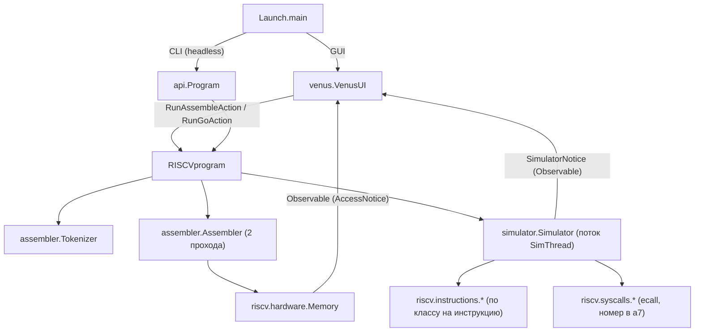

# Обзор проекта

## Назначение

RARS (RISC-V Assembler and Runtime Simulator) — учебный эмулятор ассемблера RISC-V, GUI на Java Swing. Данный репозиторий (`rars-cu`) — форк [thethirdone/rars](https://github.com/thethirdone/rars) (в свою очередь, форк MARS) для курса АКОС в ЦУ. Все задачи форка из `FORK-CHANGES.md` реализованы: функциональные — запуск первой функции с аргументами при отсутствии `main`/`_start`, комментарии `//` и отображение регистров в signed/unsigned/hex (разделы 1–3 в [04-extension-points.md](04-extension-points.md)); плюс улучшения UI (раздел 6 там же).

## Структура каталогов

```
rars-cu/
├── src/                    # исходники и ресурсы
│   ├── rars/               # весь Java-код (корневой пакет rars)
│   │   ├── api/            # программный API (Program, Options)
│   │   ├── assembler/      # токенизатор, ассемблер, символы, макросы
│   │   ├── extras/         # Documentation.java — генератор markdown-доков
│   │   ├── riscv/          # ISA: инструкции, hardware (память/регистры), syscalls, dump
│   │   ├── simulator/      # Simulator, Backstepper, ProgramArgumentList
│   │   ├── tools/          # инструменты меню Tools (BitmapDisplay, CacheSimulator, ...)
│   │   ├── util/           # Binary, SystemIO, PropertiesFile, FilenameFinder, ...
│   │   └── venus/          # GUI (редактор, панели, экшены, настройки)
│   ├── jsoftfloat/         # git-submodule: software float (эмуляция FPU)
│   ├── META-INF/MANIFEST.MF
│   ├── Config.properties   # лимиты (MessageLimit, ErrorLimit, BackstepLimit), расширения файлов
│   ├── Syscall.properties  # маппинг «имя syscall = номер»
│   ├── PseudoOps.txt       # псевдоинструкции RV32
│   ├── PseudoOps-64.txt    # псевдоинструкции RV64
│   ├── Settings.properties # дефолты настроек GUI (фактические — в java.util.prefs)
│   ├── help/               # HTML-справка
│   └── images/             # иконки
├── test/                   # Test.java (headless-тесты через rars.api) + *.s + riscv-tests/
├── docs/agents/            # эта документация
├── build.gradle, settings.gradle, gradle-build.sh  # основная сборка (gradle)
├── build-jar.sh            # альтернативная сборка (чистый javac)
├── test.sh                 # запуск тестов
└── FORK-CHANGES.md         # задачи форка (все реализованы)
```

Всего ~337 Java-файлов. Классов `BackgroundParser`, `SourceTokenList`, `Simulation`, `DPFSimulator` в проекте **нет** (проверено) — токенизация целиком в `rars.assembler.Tokenizer`, симуляция — в `rars.simulator.Simulator`.

## Сборка и запуск

```bash
git submodule update --init   # JSoftFloat (обязательно)
./gradle-build.sh              # gradle build → build/libs/rars-cu-<дата>.jar (+ копия в корень)
gradle build --no-daemon       # альтернатива: только сборка
java -jar rars-cu-<дата>.jar   # GUI
java -jar rars-cu-<дата>.jar h # CLI-справка (список опций — в javadoc Launch)
javac -cp build/libs/<jar> test/Test.java && java -cp test:build/libs/<jar> Test   # тесты
```

- Сборка — gradle (`build.gradle`, `settings.gradle`); также есть `build-jar.sh` (чистый `javac` → `rars.jar`). Java-версия: код рассчитан на Java 8+ (использует `java.util.Observable`, Swing).
- Известный сбой тестов: `test/selfmod.s` падает и на оригинальной сборке (не регрессия форка).
- `test/Test.java` — прогон ассемблерных программ из `test/*.s` через `rars.api.Program` в headless-режиме.
- `rars/extras/Documentation.java` — отдельный `main()` для генерации markdown-таблиц (директивы, syscall'ы, инструкции); не часть GUI.

## Точка входа и режимы

`src/rars/Launch.java`:

- `main(String[])` → `new Launch(args)` → `Globals.initialize()`.
- **GUI**: без аргументов или с флагом `g` → `launchIDE()` → `new VenusUI("RARS " + Globals.version, files)`.
- **CLI (headless)**: `System.setProperty("java.awt.headless", "true")`, разбор аргументов в `parseCommandArgs()` (L252–444): `a`, `ae/se<n>`, `dec/hex/ascii`, `dump <segment> <format> <file>`, `mc <config>`, `nc`, `np`, `p`, `sm`, `smc`, `we`, `me`, `ic`, `g`, `h`, `<n>` (макс. шагов), `$<reg>`/`<reg>` (печать регистра), `<m>-<n>` (диапазон памяти), `pa` (аргументы программы — всё после). Затем `runCommand()` через `rars.api.Program`, пост-мортем (`displayAllPostMortem`), `dumpSegments()`, `System.exit(Globals.exitCode)`.

## Глобальное состояние

`src/rars/Globals.java` — центральные синглтоны:

- `instructionSet` (`riscv.InstructionSet`), `memory` (`riscv.hardware.Memory`), `symbolTable` (`assembler.SymbolTable`), `settings` (`Settings`), `program` (`RISCVprogram`).
- `memoryAndRegistersLock` (`ReentrantLock`) — **все** обращения к памяти/регистрам из внешних потоков должны выполняться под этой блокировкой (её же берёт `Simulator.SimThread`).
- `Globals.initialize()` — обязательная точка старта; читает `Config.properties` и `Syscall.properties`.
- `Globals.getGui()` — доступ к `VenusUI` из любой точки GUI-кода.

## Настройки

`src/rars/Settings.java` (`extends Observable`, уведомляет GUI через `setChanged(); notifyObservers()`):

- Трёхуровневое хранение: (1) `java.util.prefs.Preferences` (персистентно, ОС-зависимо); (2) дефолты `src/Settings.properties`; (3) статические дефолты в классе.
- `enum Bool`: `DISPLAY_VALUES_IN_HEX`, `RV64_ENABLED`, `START_AT_MAIN`, `PROGRAM_ARGUMENTS`, `GENERIC_TEXT_EDITOR`, `SELF_MODIFYING_CODE_ENABLED`, `ASSEMBLE_ALL` и др.
- Строковые настройки (индексы `EXCEPTION_HANDLER`…`EDITOR_POPUP_PREFIX_LENGTH`), шрифты, цвета (`ColorMode`), стили подсветки синтаксиса.
- `setBooleanSetting` (персистентно) vs `setBooleanSettingNonPersistent` (только память).

## Общая схема взаимодействия



Дальше: [02-core-pipeline.md](02-core-pipeline.md) — конвейер ассемблирования и симуляция; [03-gui-venus.md](03-gui-venus.md) — GUI.
