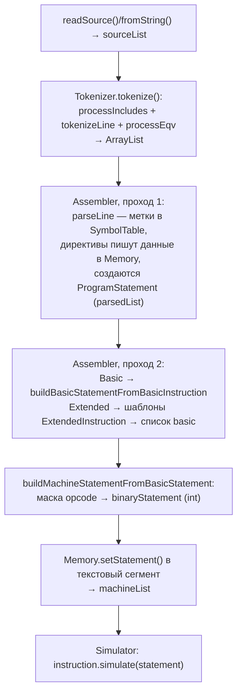

# Ядро: ассемблирование, память, симуляция

Пакеты: `rars.assembler`, `rars.riscv` (+`hardware`, `instructions`, `syscalls`, `dump`), `rars.simulator`, `rars.api`, корневые классы `rars`. Все пути — относительно `src/`.

## 1. Поток данных: исходник → машинный код

- **`rars/RISCVprogram.java`** — единица трансляции: `sourceList` → `tokenList` → `parsedList` → `machineList`; владеет `BackStepper`, локальной `SymbolTable`, `MacroPool`, `Tokenizer`. Ключевые методы: `readSource()`, `fromString()`, `tokenize()`, `assemble()`, `simulate()` / `startSimulation()`.
- **`rars/ProgramStatement.java`** — одно утверждение: исходник, `originalTokenList`/`strippedTokenList`, ссылка на `Instruction`, операнды `int[]`, адрес текста, `binaryStatement` (32-бит машинный код). Кодогенерация: `buildBasicStatementFromBasicInstruction()` (L172), `buildMachineStatementFromBasicStatement()` (L382, внутри — `insertBinaryCode()` L694: упаковка операндов по 32-символьной маске).

### Токенизация (`rars/assembler/`)

- `Tokenizer.tokenize(RISCVprogram)` (L91): `processIncludes()` (рекурсивный `.include` с защитой от циклов) → `tokenizeLine()` по строкам → `processEqv()` (`.eqv`-подстановки).
- **Комментарий** распознаётся в `tokenizeLine`, общий кейс `switch(c) { case '#': case '/': ... }` — `#` или `//` до конца строки даёт токен `TokenTypes.COMMENT` (классификация — `TokenTypes.matchTokenType`); одиночный `/` — обычный символ. Подробности — в [04-extension-points.md](04-extension-points.md), раздел 1.
- `Token.java`, `TokenList.java`, `TokenTypes.java` (enum: `COMMENT, DIRECTIVE, OPERATOR, DELIMITER, REGISTER_NAME, FP_REGISTER_NAME, CSR_NAME, IDENTIFIER, QUOTED_STRING, PLUS, MINUS, COLON, ERROR, MACRO_PARAMETER, ...`).
- `Directives.java` (`.text`, `.data`, `.word`, `.eqv`, `.include`, `.macro`, ...), `DataTypes.java` — размеры типов.
- `Symbol.java` / `SymbolTable.java` — таблица символов; **`static String startLabel = "main"`**, `getStartLabel()` (L274).
- `Macro.java` / `MacroPool.java` — поддержка `.macro`/`.end_macro`.
- `OperandFormat.java` — сопоставление операндов шаблону инструкции (по токенизированному примеру из `Instruction`).
- `SourceLine.java` — строка + `RISCVprogram` + номер строки (после `.include`).

### Ассемблер (`rars/assembler/Assembler.java`)

Двухпроходной, единственный публичный метод `assemble(...)` возвращает `ArrayList<ProgramStatement>`:

1. **Проход 1** (L111–188): `parseLine()` (L346) — метки (`parseAndRecordLabel`), директивы (`executeDirective` → запись в память данных), инструкции — `matchInstruction(token)` (L823) по мнемонике из `Globals.instructionSet`. Прямые ссылки в данных разрешаются внутренним классом `DataSegmentForwardReferences`.
2. **Проход 2** (L190–270): для basic — `buildBasicStatementFromBasicInstruction()`; для extended (псевдо) — `ExtendedInstruction.getBasicIntructionTemplateList()` даёт шаблоны с маркерами `RGn/LLn/LHn/PCLn…`, псевдоинструкция разворачивается в несколько `ProgramStatement`. Затем машинный код.

Ошибки собираются в `ErrorList` и бросаются как `AssemblyException`.

## 2. Память и регистры (`rars/riscv/hardware/`)

### `Memory` (extends Observable, синглтон `getInstance()` L278; есть `swapInstance` для `api.Program`)

- Текстовый сегмент — таблица `ProgramStatement textBlockTable[][]`, данные — байтовые блоки `dataBlockTable[][]` (блочно-ленивая структура).
- API: `get/set` (+`Word/Half/Byte/DoubleWord`), `getStatement(pc)`, `setStatement`, `allocateBytesFromHeap` (sbrk).
- **Все методы записи интегрированы с `BackStepper`**: например, `setWord` (L499) при включённом backstepping добавляет restore-запись.
- Границы сегментов — статические поля (`textBaseAddress` = 0x00400000, `dataSegmentBaseAddress` = 0x10000000, `stackPointer`, `globalPointer`, ...), устанавливаемые из `MemoryConfigurations.getCurrentConfiguration()` в `setConfiguration()` (L297).
- `MemoryConfiguration` — 16 именованных параметров (base-адреса сегментов, gp, heap, stack, kernel, MMIO, лимиты); пресеты в `MemoryConfigurations`; выбор — строковая настройка `Settings.MEMORY_CONFIGURATION`.

### Регистры

- `Register` (extends Observable) — `name`, `number`, `volatile long value`; `getValue()` уведомляет наблюдателей (`AccessNotice.READ`), есть `getValueNoNotify()`. `RegisterBlock` — общий массив-контейнер.
- `RegisterFile` — целочисленные x0–x31 (`zero, ra, sp, gp, tp, t0–t2, s0/s1=fp, a0–a7, ...`) + отдельный `programCounter`. Методы: `updateRegister` (игнорирует запись в x0), `getValue/getValueLong`, `getRegister` (алиас `fp`→`s0`), `initializeProgramCounter(boolean startAtMain)` (L180: при `Settings.Bool.START_AT_MAIN` PC = адрес метки `SymbolTable.getStartLabel()`, иначе `textBaseAddress`; `resetRegisters()` L244 — та же логика), `incrementPC()` (+4).
- `FloatingPointRegisterFile` — f0–f31 (`ft0…, fs0…, fa0…`).
- `ControlAndStatusRegisterFile` — CSR (`ustatus, uie, uip, uepc, cycle, instret, time`...), константы `EXTERNAL_INTERRUPT=0x100`, `TIMER_INTERRUPT=0x10`, `SOFTWARE_INTERRUPT=0x1`. Декораторы: `ReadOnlyRegister`, `MaskedRegister`, `LinkedRegister`.
- `InterruptController` — отложенные прерывания и трапы (см. симулятор).
- `AccessNotice` / `RegisterAccessNotice` / `MemoryAccessNotice` — объекты уведомлений Observable; `AddressErrorException` — ошибка адреса/выравнивания.

## 3. Представление инструкций (`rars/riscv/`)

- `Instruction` (абстрактный): `mnemonic`, `exampleFormat`, `description`, `createExampleTokenList()` — пример использования токенизируется для сопоставления `OperandFormat`.
- `BasicInstruction`: конструктор принимает пример, описание, `BasicInstructionFormat` (R/I/J/I-branch/...), `operMask` — **32-символьная битовая маска**, где `0/1` — константные биты, `f/s/t` — позиции 1/2/3-го операнда. Из маски выводятся `opcodeMask`/`opcodeMatch` (L83–84) — для кодогенерации и обратного декодирования. Каждый подкласс реализует `simulate(ProgramStatement)`.
  - Пример: `instructions/ADD.java` extends `instructions/Arithmetic.java`; базовый класс строит маску `funct7 + " ttttt sssss " + funct3 + " fffff 0110011"`.
- `ExtendedInstruction` — псевдоинструкция: список `translationStrings` (шаблоны базовых инструкций с маркерами `RGn, LLn, LHn, PCLn…`), `getInstructionLength()` = число базовых × 4.
- **Загрузка**: `InstructionSet.populate()` (L89) — `addBasicInstructions()` сканирует каталог `rars/riscv/instructions` через `util.FilenameFinder` и рефлексией инстанцирует все ~149 классов; псевдоинструкции читаются из ресурсов `/PseudoOps-64.txt` (при rv64) и `/PseudoOps.txt`. Строятся `opcodeMatchMaps` (mask → match → instruction) для `findByBinaryCode(int)`. Флаг rv64 — из `Settings.Bool.RV64_ENABLED`.

### Формат `PseudoOps.txt`

Строка: `мнемоника шаблон ;перевод1 ;перевод2 ;#описание`, например `mv t1,t2 ;add RG1, x0, RG2`.

## 4. Симулятор (`rars/simulator/`)

- **`Simulator`** — синглтон, `extends Observable`. Два режима: `simulate(pc, maxSteps, breakPoints)` — блокирующий; `startSimulation(...)` — в отдельном потоке `new Thread(new SimThread(...), "RISCV")` (L124–127). `Reason` enum: `BREAKPOINT, EXCEPTION, MAX_STEPS, NORMAL_TERMINATION, CLIFF_TERMINATION, PAUSE, STOP`. Управление: `stopExecution()/pauseExecution()`. GUI-наблюдатели получают `SimulatorNotice`.
- **Шаг выполнения** (`SimThread.run()`, L336–572):
  1. `Globals.memoryAndRegistersLock.lock()`.
  2. Обработка отложенных прерываний/трапов через `InterruptController` + CSR (`uip/uie/ustatus`), порядок: external → software → timer → trap.
  3. `pc = RegisterFile.getProgramCounter()`; при активном режиме запуска функции — проверка `pc == FunctionRun.returnAddress` (sentinel в `ra`) → `NORMAL_TERMINATION`. Проверяется **до** лимита шагов, чтобы инструкция `ret` завершала программу ровно за один шаг.
  4. Проверка лимита шагов.
  5. `RegisterFile.incrementPC()`.
  6. `statement = Globals.memory.getStatement(pc)`; `null` → `CLIFF_TERMINATION`; `AddressErrorException` → трап/`SimulationException`.
  7. `instruction.simulate(statement)` — фактическое исполнение (L484).
  8. Управляющие исключения: `BreakpointException` (EBREAK), `WaitException` (WFI — поток ждёт `wait()`), `ExitingException` (syscall exit → `NORMAL_TERMINATION`), `SimulationException`.
  9. Инкремент CSR `cycle/instret/time`, брейкпоинты, обновление GUI через `SwingUtilities.invokeLater`, троттлинг по `RunSpeedPanel`.
- **`BackStepper`** — стек отката (`BackstepStack`, лимит `Globals.maximumBacksteps` из `Config.properties`): enum `Action` (`MEMORY_RESTORE_*, REGISTER_RESTORE, PC_RESTORE, CONTROL_AND_STATUS_REGISTER_RESTORE/BACKDOOR, FLOATING_POINT_REGISTER_RESTORE, DO_NOTHING`); `backStep()` выполняет undo. Записи добавляются из `Memory.set*`/методов регистров. Создаётся в `RISCVprogram.assemble()` после успешной сборки.
- **`ProgramArgumentList.storeProgramArguments()`** (L128) — кладёт строки-аргументы и указатели на стек, `argc`→`a0`, `argv`→`a1`. Вызывается из `api.Program.setup()` и из GUI (`RunGoAction.processProgramArgumentsIfAny`, `RunStepAction`) при `Settings.Bool.PROGRAM_ARGUMENTS`.
- **`FunctionRun`** — статическое состояние режима «запуск программы как функции» (нет `main`/`_start`): sentinel-адрес возврата в `ra`, имя функции, аргументы, признак возвращаемого значения. Настраивается из GUI (`venus.run.FunctionRunSupport`), сбрасывается при ассемблировании/сбросе. Подробности — в [04-extension-points.md](04-extension-points.md), раздел 3.

## 5. Программный API (`rars/api/`)

- `Program.java` — headless-использование: `assemble(files, main)`, `assembleString()`, `setup(args, STDIN)`, `simulate()`, `getSTDOUT()/getSTDERR()/getExitCode()/getMemory()`, `get/setRegisterValue`. Хранит отдельные копии памяти `assembled` и `simulation` (обмен через `Memory.swapInstance`).
- `Options.java` — набор настроек для `Program`.

## 6. Системные вызовы

- `rars/riscv/AbstractSyscall.java`: конструктор `AbstractSyscall(String name [, descr, in, out])`; номер **обязан быть `-1`** (назначается загрузчиком); абстрактный `simulate(ProgramStatement)` — вызывается при `ecall`, номер сервиса в `a7`.
- Реализации — `rars/riscv/syscalls/Syscall*.java` (~45: `SyscallPrintInt`, `SyscallReadInt`, `SyscallExit`, `SyscallSbrk`, `SyscallOpen/Read/Write/Close/LSeek`, диалоги, `SyscallRand*`, MIDI и др.).
- **Регистрация** — `rars/riscv/SyscallLoader.java`: static-блок сканирует каталог `rars/riscv/syscalls`, рефлексией инстанцирует все `extends AbstractSyscall`, затем `processSyscallNumberOverrides()` назначает номера из `Syscall.properties` (несовпадение количества записей и классов — `System.exit(0)`). Поиск: `SyscallLoader.findSyscall(int number)`.

**Добавление syscall**: класс `SyscallFoo extends AbstractSyscall` (номер `-1`) + строка `Foo = <номер>` в `src/Syscall.properties`; ресурсы должны быть на classpath при запуске.

## 7. Дамп памяти (`rars/riscv/dump/`)

`DumpFormat`/`AbstractDumpFormat` + форматы `BinaryDumpFormat`, `HexTextDumpFormat`, `IntelHexDumpFormat`, `AsciiTextDumpFormat`, `BinaryTextDumpFormat`, `SegmentWindowDumpFormat`; `DumpFormatLoader` — динамическая загрузка (CLI-опция `dump`).

## 8. Исключения и распространение ошибок

| Класс | Когда | Путь |
|---|---|---|
| `ErrorMessage` / `ErrorList` | Накопитель ошибок/предупреждений (файл, строка, колонка, сообщение) | `src/rars/` |
| `AssemblyException` | Бросается токенизатором/ассемблером, несёт `ErrorList` | `src/rars/` |
| `AddressErrorException` (extends Exception) | Неверный адрес/выравнивание; внутри `int type` | `rars/riscv/hardware/` |
| `SimulationException` | Ошибка времени выполнения (`ILLEGAL_INSTRUCTION`, `INSTRUCTION_ADDR_MISALIGNED`, `LOAD_ACCESS_FAULT`, `*_INTERRUPT`, ...); может перехватываться trap-обработчиком (`InterruptController.registerSynchronousTrap`) | `src/rars/` |
| `ExitingException` | Управляющий сигнал завершения (syscall exit/exit2); `error()==null` → `NORMAL_TERMINATION` | `src/rars/` |
| `BreakpointException`, `WaitException` | EBREAK и WFI как исключения | `src/rars/` |

Поток ошибок сборки: `Tokenizer`/`Assembler` → `ErrorList` → `AssemblyException` → вызывающему (GUI / `Program.assemble` / `Launch`). Поток ошибок исполнения: инструкция бросает `SimulationException` → `SimThread` регистрирует трап (или останавливает `stopExecution(true, Reason.EXCEPTION)`) → ретранслируется из `Simulator.simulate()`.
